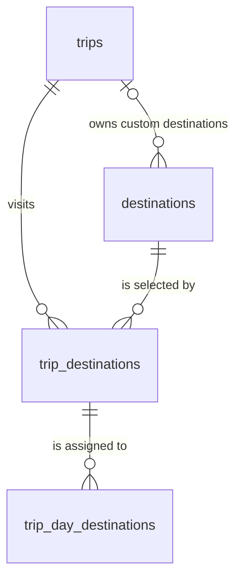

# Tripo — Project Spec

Read this file first when working on Tripo. Product UI, API docs, report, and slides are in English.

## 1. Product and MVP goal

Tripo combines a travel community with shared trip planning. Travelers browse photo stories, publish recommendations, and organize trips with an interactive calendar and budget. Mobile uses a daily timeline; desktop shows up to three consecutive days. The agreed product direction is in `PRODUCT.md`.

The target is a public production release for real users, with open registration and free service tiers. The original demo flow remains a baseline, not proof of production readiness. See `working-on-tripo.md` for the release checklist and unverified items.

## 2. Stack and deployment

- Frontend: React + Vite in `web/`.
- API: Node.js + Express REST API using ES modules in `api/`.
- Authentication: Clerk. The API verifies Clerk sessions; the app stores a local user profile mapped by Clerk user ID. Tripo does not store passwords.
- Database: MySQL through `mysql2/promise`; schema migrations and seed data live in `api/database/`. Target TiDB Cloud Starter in MySQL compatibility mode for production and labelled sample content in one shared database; the provisioned database is named `tripo` and requires TLS. Its current deployment state must be verified.
- Hosting: deploy `web/` and `api/` as separate Vercel projects from this monorepo. The API runs as a Vercel Function. The shared database is managed and remote; do not use a teammate's laptop database.
- Local development: developers may use local MySQL. Production and shared demos must use the managed remote database, never a teammate's laptop database.
- Secrets: never commit `.env`, keys, or passwords. Commit `.env.example` only. Keep Clerk secret, database credentials, and provider secrets in the API deployment's environment settings. Only public client keys may use the Vite `VITE_` prefix.

The API must handle requests without relying on in-memory state surviving between invocations. Collaboration uses the shared database revision and bounded HTTP long polling; no always-open server or process-local event registry is required. See `adr/0001-bounded-trip-long-polling.md` for the transport and its costs.

## 3. Feature scope

### Core trip flow

1. **Authentication and profile**: register/sign in/sign out through Clerk. Create or update a local profile from the verified Clerk identity. Reject unauthenticated writes.
2. **Trips**: an organizer creates, reads, updates, and deletes a trip with title, one or more destinations, start date, end date, group size, one currency code, and whole-trip budget.
3. **Itinerary**: one day per calendar date in the inclusive trip date range. The owner and invited members add, edit, and delete activities. Calendar gestures move events across dates and hours, resize duration, and move between timed and unscheduled areas. An Edit form provides a keyboard alternative.
4. **Activities**: category, optional local time and duration, place/city/address, planned cost, actual spend (nullable), note, manual visited check-in, and an “Open in Google Maps” search link built from the address (no Maps API key).
5. **Budget**: show recorded spend, remaining or over-budget amount, and a breakdown by activity and category. Planned cost is not counted as recorded spend.
6. **Destinations and places**: browse curated seed data for destinations and places (sightseeing, food/drink, accommodation), and associate destinations with trips.
7. **Read-only sharing**: the organizer enables an unlisted link, can revoke or regenerate it, and anyone with an active link can read only the fields intended for sharing.

### Community and supporting features

- **Travel-story feed**: visitors browse public posts with a scrollable photo gallery; signed-in users publish with an optional photo preview, like a post once, and comment. Feed and comments are paginated; comments load when opened. Stories are persistent posts, not ephemeral 24-hour stories.
- **Weather** (OpenWeather through the API): target release feature; hide or clearly mark any feature that has not passed its release checks.

## 4. Rules and invariants

- **Dates**: start and end are inclusive. Number of days = calendar difference + 1. Reject an end date before the start date. Activities must belong to a date inside the trip range.
- **Money**: use MySQL `DECIMAL`, never floating-point storage. Reject negative values. One currency per trip; no conversion.
- **Actual spend**: `NULL` means not recorded, not zero. Totals treat `NULL` as zero and label the sum “recorded spend.”
- **Budget**: remaining = trip budget − sum of recorded actual spend. Clearly show the over-budget amount when remaining is negative.
- **Categories**: sightseeing/check-in, food/drink, accommodation, transport, shopping, other.
- **Permissions**: enforce authorization on the server for every write. The owner and accepted members may edit a trip and its activities. Only the owner deletes a trip or manages invitations/members/share links. Public share links grant read access only. Hiding a UI control is not authorization.
- **Conflicts and synchronization**: activity PATCH/DELETE require the version last read and return 409 `ACTIVITY_CONFLICT` for stale writes. Trip PUT requires the revision last read and returns 409 `TRIP_CONFLICT` if it changed. Trip revision increments in the same transaction as detail/activity changes. The visible online trip watches for revisions, refreshes only on change, and pauses while editing or saving. Schedule changes appear optimistically and are restored on failure.
- **Time and offline behavior**: a trip uses an explicitly confirmed IANA destination zone. Activity dates and times are local wall times; do not infer a missing zone from the device. Loaded trip data stays readable in memory when offline. Calendar writes are disabled and trip mutations reject before changing local state; there is no offline write queue or persistence across reloads. DST gaps and ambiguous wall times remain unresolved.
- **Share token**: generate a random high-entropy token on the server; never expose a sequential trip ID as the token. Revoked or replaced tokens stop working. The public endpoint returns only reader-safe fields and excludes private posts, credentials, and internal identifiers not needed by the viewer.
- **Secrets and logs**: never return passwords, credentials, Clerk tokens, or share tokens in logs or error messages.
- **Errors**: API errors use `{ "error": { "code": "...", "message": "..." } }`.
- **SQL**: use parameterized queries.
- **UI states**: every screen handles loading, empty, error, and success states.

## 5. Data model

Core tables: `users` (with unique `clerk_user_id`), `trips`, `destinations`, `trip_destinations`, `trip_day_destinations`, and `activities`. The share token is stored on the trip.

Catalog destinations have a null `destinations.custom_trip_id`. A custom destination belongs to exactly one trip through that nullable foreign key, and its ID is linked through `trip_destinations` in visiting order. Custom destinations appear in that trip and its shared itinerary and are excluded from public catalog searches. They have a map search link and need confirmed location data before weather is available.

Secondary tables: `destinations`, `places`, `posts`, `post_photos`, `post_comments`, `post_likes` (unique per user and post), `pending_photo_deletes`, `trip_members`, `trip_invites`, and `trip_weather_location`. `trips.revision` and `activities.version` serve different purposes: refresh detection and conflicting-write protection respectively. Days are derived from the trip date range, not stored in a `trip_days` table.

Use foreign keys and database constraints for invariants that can be safely enforced in MySQL. Keep migrations repeatable where practical and seeds fictional and safe to rerun.

## 6. API and team conventions

- REST routes live under `/api`, use plural nouns, and return JSON. `GET /api/health` reports API and database readiness without exposing credentials.
- Keep `docs/api/openapi.yaml` aligned with implemented endpoints and request/response shapes.
- Branches use `feat/<short-name>`. Each PR should be one coherent, reviewable change; a teammate runs the relevant flow before merge.
- Record material choices and their rationale in `docs/decisions.md`; new architecture decisions have one file per decision under `docs/adr/`.
- Build features as vertical slices across UI, API, and database migration. Agree on request/response shapes before parallel UI/API work.

## 7. Out of scope

Chat, notifications, ephemeral stories, offline editing, currency conversion, bill splitting, payments, scraping Google Maps, embedded maps, long-range forecasts, and video.
