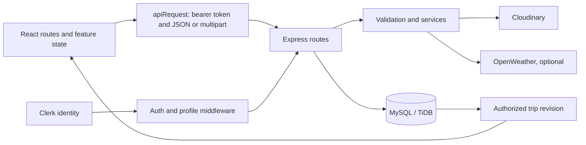

# Working on Tripo

This guide describes the current implementation. Read `PRODUCT.md` for product intent, `docs/spec.md` for rules, `docs/api/openapi.yaml` for the HTTP contract, and `docs/decisions.md` plus `docs/adr/` for architecture decisions. `docs/acceptance-checklist.md` records historical production checks; its results do not validate later changes.

## First local run

1. Use Node.js 24 LTS and local MySQL. Create `tripo_dev` with `utf8mb4`, matching `api/.env.example`.
2. Copy `api/.env.example` to `api/.env`. Configure the local database, `CLIENT_ORIGIN=http://localhost:5173`, and Clerk server keys. Never use the shared demo database for automated tests.
3. Apply migration SQL files in numeric order, then the fictional seeds. Migrations are not all repeatable: record which files have been applied and do not blindly rerun them. SQL execution is manual; this repository has no migration CLI or automatic migration ledger.
4. Copy `web/.env.example` to `web/.env.local`. Set `VITE_API_BASE_URL=http://localhost:4000` and the Clerk publishable key. Server secrets belong only in the API environment; no secret may use the `VITE_` prefix.
5. Open two terminals and run:

```sh
# Terminal 1, from the repository root
cd api
npm ci
npm test
npm run dev
```

```sh
# Terminal 2, from the repository root
cd web
npm ci
npm test
npm run build
npm run dev
```

The web runs on port 5173; the API on 4000. `/api/health` reports database connectivity, and `/api-docs` serves Swagger UI. Clerk sign-in requires a configured app and allowed redirect origins. Cloudinary is required for story photo uploads; OpenWeather is optional. Neither provider is required by the automated tests. If Vite reports `Outdated Optimize Dep` after SSR tests, restart the development server with `npm run dev -- --force`.

## Architecture and ownership boundaries



| Change | Start here | Related checks |
| --- | --- | --- |
| Navigation or route loading | `web/src/main.jsx`, `web/src/App.jsx` | `web/test/navigation.test.js`, production build |
| Social feed or composer | `web/src/features/posts/PostsFeed.jsx` | `web/test/story-image.test.js`, `api/test/feed.test.js`, upload tests |
| Image delivery | `web/src/lib/cloudinary-image.js` | Responsive-image tests, browser network panel |
| Trip calendar gestures | `TripCalendar.jsx`, `calendar-math.js`, `trips.css` | Calendar math tests, desktop/mobile pointer checks |
| Trip local writes and sync | `TripDetail.jsx`, `schedule-update.js`, `trip-polling.js` | Schedule/poller tests and two signed-in sessions |
| Trip API and permissions | `api/src/routes/trips.js`, `activities.js`, `share.js` | `api/test/trip-writes.test.js`, share-view tests |
| Profile or upload validation | `api/src/middleware/`, `api/src/services/profiles.js` | Profile/upload tests; retain trust-boundary checks |
| Dashboard and weather | `web/src/features/dashboard/`, `api/src/services/weather.js` | Dashboard/timezone/weather tests |
| Data changes | `api/database/migrations/` | API contract, migration order, backup and rollback notes |

Trip filenames above are under `web/src/features/trips/`. Routes compose existing services and parameterized SQL; there is no ORM. Test files use Node's built-in test runner. API write tests use isolated SQLite fixtures with the real Express routes; they do not prove MySQL/TiDB locking or production behavior. UI tests render real components through Vite SSR; they do not replace pointer/touch testing.

## One calendar write, end to end

1. `TripCalendar` snaps a move/resize to 15-minute increments and calls `TripDetail.saveSchedule` with the activity's version.
2. The mutation lock rejects offline and concurrent writes. Local schedule state updates immediately, without reloading the whole trip on a successful move.
3. `PATCH /api/activities/:id` validates fields, membership, trip date bounds and version inside a transaction. It updates the activity and increments both activity version and trip revision.
4. A stale activity version returns 409 `ACTIVITY_CONFLICT`. The client restores/reloads the server schedule and shows the conflict. Budget calculations remain on the server.
5. Other viewers detect the revision and fetch trip detail. Full trip edits send the revision captured when the form opened; stale writes return 409 `TRIP_CONFLICT`.

The mobile calendar shows one day, desktop up to three consecutive days. Events can move to another date/hour or to an unscheduled area; the Edit form is the keyboard alternative. A trip has one explicitly confirmed IANA time zone. Dates and hours are destination-local wall times, with DST gaps/ambiguities still unresolved. Cross-midnight activities remain clipped at the bottom of the current day and labelled as continuing; the calendar does not split them into a second-day event.

## Collaboration, offline and failure handling

Owners create single-use invitation tokens valid for 24 hours. The API stores only token hashes. Recipients sign in and explicitly accept; a public share link never grants edit permission. Owners alone manage membership, delete trips, and change share links.

The visible, online trip uses `GET /api/trips/:id/version?sync=1&wait=1&since=<revision>`. The server checks the authorized database revision about once per second and holds an unchanged request for up to eight seconds of waiting, excluding database/auth latency. The completed response signals immediate renewal. Full detail loads only when the revision differs. This is bounded long polling; it does not guarantee instantaneous delivery. See [ADR-0001](adr/0001-bounded-trip-long-polling.md).

Polling continues while an existing activity is being edited; its form retains the original activity and version even if another member moves, changes or removes it. A stale save reports a conflict without closing the form. Polling pauses during other forms, gestures, writes, hidden tabs and offline state. Cancellation ignores stale results; failures preserve loaded data and retry after five seconds. An older API without the renewal hint retains the five-second client delay. Loaded trip data stays in memory when offline; calendar writes are disabled and trip mutations reject before changing local data. Reloading offline is unsupported, and there is no offline write queue.

Every trip-detail writer must increment the revision in its transaction. Direct SQL and old deployments bypass revision detection. An idle viewer costs roughly 450 version HTTP requests and 3,600–4,050 revision queries per hour, excluding authentication and latency; multiple viewers multiply that work. Changes add full-detail requests. Refreshes use a per-process allowance of 600 requests per 15 minutes, keyed by authenticated user or by IP for anonymous requests; other API requests retain the per-process IP allowance of 120. These are not shared global quotas. Multiple tabs for one user share the sync allowance. Measure provider use before increasing concurrency.

## Database rollout and recovery

| Migration | Purpose | Compatibility concern |
| --- | --- | --- |
| 001–006 | Users, destinations, trips, feed, photos, activities, search | Base schema and seeds |
| 007 | Pending Cloudinary deletes | Keep the queue; `npm run photos:retry` retries failures |
| 008 | Nullable activity duration | Existing activities retain unknown duration |
| 009 | Members and hashed invitations | Retain tables on rollback to preserve access records |
| 010 | Activity version | New API requires version on PATCH/DELETE; old clients must reload |
| 011 | Trip revision | All writers must participate before relying on sync |
| 012 | Explicit weather location | Retain configured locations on rollback |
| 013 | Confirmed trip time zone | Do not infer an unknown zone from the device |
| 014 | Shared post/upload limits | Apply before API rollout; keep table on rollback |

Back up the target database before deployment, record applied migrations, and apply only unapplied migrations in order. Quiesce old writers for revision-aware cutover. Deploy the API and reload active clients; configure function duration to cover the eight-second wait plus auth/database latency. The long-poll extension adds no new migration. To roll it back, restore the old web interval or immediate version endpoint while retaining all data columns/tables. Roll back API code before removing schema; dropping collaboration columns/tables destroys data and is not a routine rollback.

## Performance evidence and how to measure

The build measured in this continuation changed entry JavaScript from 430.79 kB (123.27 kB gzip) to 361.70 kB (106.37 kB gzip), with route features split into separate chunks. This measures bundle delivery only. It is not evidence of production LCP, image-download duration, database latency or perceived speed.

Feed images already use responsive Cloudinary derivatives, lazy loading and original-image fallback. The first feed image has high fetch priority. Signed/private/already-transformed/external URLs are left alone. Comments load only when opened; feed pages load on demand. Check the network panel before blaming image payload or changing database queries.

For repeatable measurements, record commit/diff, viewport, browser, network conditions, cache state, number of posts/activities and concurrent viewers. Compare cold navigation and warm navigation, feed image bytes and LCP, initial trip load, gesture feedback and mutation latency, and remote-edit-to-render delay using two independent sessions. Record failures, conflict behavior, request/query rates and hosting cost. Local fixture timing and production timing must be labelled separately. No live production performance measurement is claimed by this guide.

## Team change and review workflow

1. Trace the entry point, callers, API, schema, permissions and existing tests. Keep a PR to one complete user behavior; coordinate ownership when editing the same files.
2. Agree on request/response shapes before parallel UI/API work. Update OpenAPI for contract changes. Add focused regression tests for new logic; keep test fixtures isolated from provider credentials.
3. For schema or transport changes, document compatibility, cutover, rollback and data preservation before release. Add one ADR for each material architecture decision.
4. Run both `npm test` suites and the web build. Neither package currently defines a lint/typecheck script. Review the diff once independently and fix real findings.
5. Check desktop/mobile, keyboard, loading/empty/error/success, stale edits, offline, and two-member synchronization. Refresh historical acceptance evidence only after rerunning the actual checks.
6. Include the problem, resulting behavior, verification and remaining limits in the PR description. Never publish secrets or private trip data in screenshots or logs.

## Before a shared demo

Use a disposable local/staging trip and two independent Clerk sessions. Verify invite acceptance, member edit, cross-day/time drag, resize, unscheduled movement, stale-version conflict, background/reconnect refresh, offline write rejection, membership revocation, and anonymous share/revoke. Confirm existing accounts/trips remain available. Check deployed API health, function timeout, upload and image delivery, and actual database usage. Automated tests and synthetic browser previews do not constitute this acceptance run.

## Public production release checklist

These are targets, not evidence of completed work. Record the date, environment and results when each check is performed.

Latest local baseline (2026-11-17): API tests 21/21 and web tests 26/26 passed; the most recent web build passed. These checks do not establish deployed behavior, TiDB concurrency, quotas, security coverage or the 20-session target. A GitHub Actions workflow is present; its first hosted run remains unverified.

TiDB read-only inspection (2026-11-17) found the configured `tripo` database has the original trip and activity columns and no membership, invitation, weather-location or write-limit tables. Migrations 008–014 are therefore not reflected in that inspected schema; verify every migration individually before applying anything. In session-local temporary tables on that TiDB instance, the write-limit SQL incremented and rolled back, and the sample feed seed produced 16 labelled stories after two executions. This does not test concurrent connections or production rollout.

On 2026-11-17, isolated schemas on the same TiDB instance were created and removed for a shared-limiter concurrency check. Twenty simultaneous calls from one account produced 10 accepted and 10 limited; twenty calls from different accounts with a test-only global cap of 12 produced 12 accepted and 8 limited. Both runs reported zero errors. These checks do not exercise deployed Vercel instances, browser sessions, other endpoints or end-to-end latency.

On 2026-11-17, all migrations 001–014 and seeds 001–003 ran successfully on a fresh isolated TiDB schema; the seed produced 16 labelled stories. A second isolated schema was populated with a fixture trip and activity after migration 007, then upgraded through 014; their titles, note and spend survived and new revision/version/nullable fields had the expected defaults. Both schemas were removed. These fixture checks do not prove that the actual production data or every upgrade edge case is safe.

On 2026-11-17, a local Express harness using an isolated TiDB schema and mocked Clerk identity sent ten simultaneous trip-version waits and ten one-time empty-feed requests, then wrote an activity. All requests succeeded and all ten waits observed the new revision. Responses arrived from 62 ms before to 980 ms after the write response; this measures HTTP revision notification, not browser rendering or sustained session latency. The schema was removed. This is not a deployed Vercel load test or proof of the 20-session release target.

A separate local mixed-workload run used ten repeating trip-revision watchers and ten repeating readers of a feed containing sample posts, plus one activity write. During approximately 19.8 seconds including long-poll drain, it completed 30 version requests and 140 feed requests; all ten watchers observed the change and no request errors occurred. It used an isolated TiDB schema and mocked Clerk identity, and the schema was removed. It did not measure browser rendering, sustained production traffic, provider quota consumption or Vercel behavior.

On 2026-11-17, another isolated TiDB fixture used two mocked identities to read the same trip revision. The owner's edit returned 200; the member's stale edit returned 409 `TRIP_CONFLICT` without overwriting it. After the owner removed that member, the member's trip read returned 404. The schema was removed. This checks the API against TiDB, not Clerk authentication or the deployed service.

An additional isolated TiDB fixture on the same date verified activity conflicts: after one editor saved version 1, another editor's stale PATCH and DELETE both returned 409 `ACTIVITY_CONFLICT`; the saved title, note and version 2 remained intact. The fixture schema was removed. This used mocked identities and a local API, not the deployed service.

Separate isolated TiDB runs also issued two simultaneous PATCH requests for activity version 1 and two simultaneous PUT requests for trip revision 1. In each run one returned 200 and one returned 409 with the corresponding conflict code; the stored row advanced once and retained the winning edit. Both schemas were removed. These are single contention trials with mocked identity, not exhaustive concurrency or deployed-service verification.

The configured deployed API health endpoint returned HTTP 200 with database connected on 2026-11-17. This does not prove it runs the current worktree or that authenticated features work. Local API configuration has no weather key; the deployed weather configuration has not been inspected. The share control states that anyone with its active link may view the trip, but deployed authorization still needs verification.

On 2026-11-17 the Cloudinary account referenced by local API credentials reported the Free plan and 0.17 of 25 credits used; this is a point-in-time observation, not a production quota guarantee. The local Clerk secret identifies a development instance; its Protect API reports `rules_enabled` and `specter_enabled` as true. Neither result proves which Cloudinary or Clerk instance the deployment uses, nor verifies its production configuration.

Local route tests exercise anonymous share access and revocation, including checks that activity notes and actual spending are excluded. They also exercise member removal and unauthorized access using SQLite fixtures; they do not verify deployed permissions or TiDB concurrency.

- [ ] Verify free-tier eligibility, quotas and zero paid spending for Vercel, Clerk, TiDB, Cloudinary and any enabled weather service. The purchased domain is the planned cost exception. Quota exhaustion and interruption are accepted risks.
- [ ] Configure public registration and production credentials; confirm the intended root domain, `api` subdomain and `www` redirect once a domain is purchased.
- [ ] Review and deploy the labelled sample stories in `002_demo_trip_and_story.sql` alongside real production data; the seed currently includes no images. Verify its storage and quota impact and obtain permission for any images added later.
- [ ] Verify shared database-backed post/upload limits on deployed TiDB across instances. Local implementation limits attempts per account and globally; registration and general API rate limits still need provider-level protection. Existing process-local API limits are not global limits.
- [ ] Verify activity and trip conflict handling on real MySQL/TiDB. Local code rejects stale trip edits; the deployed database behavior is unverified.
- [ ] Verify public feed access, trip membership authorization, and share/revoke behavior. An active read-only share link grants access to anyone possessing it.
- [ ] Verify trip planning, collaboration, calendar, feed, photos and weather; hide or clearly mark features that do not pass.
- [ ] Run a mixed workload of 20 concurrent sessions, including feed browsing and collaborative edits, in an authorized isolated environment. Measure errors, database usage and remote-edit-to-render latency against the approximately one-second target. Vercel's [load-testing policy](https://vercel.com/kb/guide/what-s-vercel-s-policy-regarding-load-testing-deployments) currently permits load testing only on Enterprise with coordination; do not load-test the Hobby deployment. An isolated test cannot alone establish Vercel production performance. Delay public launch or adjust scope if the release target cannot be verified.
- [ ] Check applied migrations and deployment compatibility, CI, production health, provider usage and rollback steps. Do not blindly rerun migrations or use production data for load tests.

The owner accepts data-loss risk and has not requested separate backup setup or a restore drill. Existing migration instructions recommend a backup; this release checklist does not claim one has been made or tested.

Vercel's [Hobby terms](https://vercel.com/legal/terms) restrict use to personal or non-commercial purposes. The owner confirmed the planned project is non-commercial; verify account eligibility and current terms before release. Clerk's [Protect setup](https://clerk.com/docs/guides/protect/getting-started) requires instance-specific configuration and a real sign-up check; its status in the production account is unverified.

The release uses the custom domains `www.tripo.website` (web) and `api.tripo.website` (API); the original `vercel.app` URLs remain as fallbacks. Vercel's [WAF rate limiting](https://vercel.com/docs/vercel-firewall/vercel-waf/rate-limiting) is available on Hobby with one rate-limit rule per project and a 10-second to 10-minute window. Review API traffic and shared-IP/long-poll behavior before choosing a threshold, then configure and verify the rule in the API project. This is separate from Clerk sign-up protection and the database-backed write limits; no WAF rule has been verified or published.
